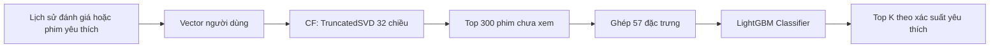

# Hệ thống gợi ý phim Hybrid AI — MovieLens 32M

Dự án xây dựng hệ thống gợi ý phim từ dữ liệu MovieLens 32M, gồm tiền xử lý dữ liệu, xây dựng đặc trưng, huấn luyện mô hình, đánh giá thực nghiệm và triển khai giao diện web **CineMatch**.

Mô hình chính sử dụng kiến trúc hai tầng: **Collaborative Filtering với TruncatedSVD** lấy các phim ứng viên, sau đó **LightGBM Classifier** dự đoán xác suất yêu thích và xếp hạng Top K. Đặc trưng đầu vào kết hợp tín hiệu cộng tác, nội dung phim và thống kê đánh giá.

## 1. Các phần nhóm đã thực hiện

| Phần việc | Nội dung | Mã nguồn và sản phẩm |
| --- | --- | --- |
| Tiền xử lý dữ liệu | Làm sạch tên phim, xử lý năm phát hành, mã hóa thể loại, trích xuất TF-IDF từ tag, chọn người dùng và chia train/test theo thời gian | `phase1_data_preprocessing.py`, notebook giai đoạn 1 |
| Collaborative Filtering | Tạo ma trận user–item dạng thưa, huấn luyện TruncatedSVD 32 chiều, lấy Top 300 ứng viên và loại phim đã xem | `phase2_collaborative_filtering.py`, notebook giai đoạn 2 |
| Content-Based Filtering | Biểu diễn nội dung phim, tạo hồ sơ sở thích từ phản hồi tích cực/tiêu cực, truy xuất theo cosine similarity | `phase2_content_based.py` |
| Huấn luyện Hybrid | Xây dựng 57 đặc trưng, lấy mẫu âm kết hợp, huấn luyện LightGBM và đánh giá phân loại | Notebook giai đoạn 3, `final.py` |
| Suy luận và đánh giá | Gợi ý cho người dùng có lịch sử và người dùng mới; so sánh CF, Hybrid và Popularity; tính các chỉ số Top K | `final.py`, `phase4_recommender.py`, `code_danh_gia.py` |
| Ứng dụng demo | Giao diện desktop bằng Tkinter và giao diện web bằng Flask, HTML, CSS, JavaScript | `phase4_demo_app.py`, thư mục `UI/` |
| Báo cáo và kiểm thử | Tài liệu thuật toán, bảng đặc trưng, kết quả thực nghiệm; kiểm tra API, mô hình, khởi động và thao tác trình duyệt | `docx/`, `excel/`, `UI/tests/` |

`final.py` tích hợp luồng tiền xử lý, CF, LightGBM và đóng gói mô hình phục vụ web. Mô-đun Content-Based Filtering triển khai riêng cách lấy ứng viên từ nội dung; ứng dụng web hiện dùng CF để lấy ứng viên và LightGBM để xếp hạng lại.

## 2. Dữ liệu và tiền xử lý

Nguồn dữ liệu là [MovieLens 32M của GroupLens](https://files.grouplens.org/datasets/movielens/ml-32m.zip), gồm `movies.csv`, `ratings.csv`, `tags.csv` và `links.csv`.

| Thống kê | Quy mô |
| --- | ---: |
| Đánh giá trong bộ dữ liệu gốc | 32.000.204 |
| Người dùng trong bộ dữ liệu gốc | 200.948 |
| Phim trong bộ dữ liệu gốc | 87.585 |
| Lượt gắn tag trong bộ dữ liệu gốc | 2.000.072 |
| Người dùng được chọn trong bộ mô hình hiện có | 20.000 |
| Tương tác train của nhóm người dùng đã chọn | 12.063.020 |
| Tương tác test của nhóm người dùng đã chọn | 3.005.773 |
| Phim có vector CF trong bộ mô hình phục vụ web | 68.357 |

Số liệu nguồn được ghi trong `README.txt` của MovieLens. Quy mô train/test đối chiếu từ log tiền xử lý; số người dùng, phim và tương tác train của bộ triển khai được kiểm tra từ `serving_artifacts.pkl`. Các giá trị này thay đổi khi huấn luyện lại với cấu hình khác.

Quy trình xử lý trong `final.py`:

1. Tách tên phim và năm phát hành bằng biểu thức chính quy.
2. Mã hóa 18 thể loại bằng multi-hot; tạo thêm số lượng thể loại của mỗi phim.
3. Làm sạch tag và trích xuất 30 đặc trưng TF-IDF.
4. Chọn tối đa 20.000 người dùng hoạt động nhiều nhất, có ít nhất 30 đánh giá.
5. Sắp xếp tương tác theo thời gian trong từng người dùng; lấy khoảng 80% đầu làm train, 20% còn lại làm test.
6. Gán nhãn yêu thích `target = 1` khi `rating >= 4.0`; các đánh giá còn lại có nhãn 0.
7. Tính thống kê người dùng và phim trên tập train để tạo đặc trưng cho mô hình chính.
8. Điền năm phát hành còn thiếu lần lượt bằng năm trong tên phim, năm đánh giá sớm nhất trong train, rồi trung vị năm phát hành.

## 3. Kiến trúc mô hình



### Tầng 1: Lấy ứng viên bằng CF

Ma trận đánh giá user–item được lưu ở dạng CSR và phân rã bằng TruncatedSVD. Điểm CF là tích vô hướng giữa vector người dùng và vector phim. Hệ thống loại phim đã xem trong train trước khi chọn tối đa 300 ứng viên.

Với người dùng mới, hệ thống lấy trung bình vector của các phim được chọn để tạo vector sở thích tạm thời. Các phim đã chọn cũng được loại khỏi kết quả gợi ý.

### Tầng 2: Xếp hạng bằng LightGBM

Bộ mô hình hiện có sử dụng 57 đặc trưng:

| Nhóm đặc trưng | Số lượng | Ví dụ |
| --- | ---: | --- |
| Tín hiệu cộng tác | 1 | `cf_score` |
| Năm phát hành và tuổi phim | 2 | `release_year`, `movie_age` |
| Thể loại | 18 | `genre_Action`, `genre_Drama` |
| Số lượng thể loại | 1 | `genre_count` |
| Nội dung tag | 30 | Các cột `tag_*` từ TF-IDF |
| Thống kê phim | 2 | `movie_avg_rating`, `movie_log_count` |
| Thống kê người dùng | 2 | `user_avg_rating`, `user_log_count` |
| Tương tác giữa người dùng và phim | 1 | `rating_diff_from_user_avg` |

LightGBM được huấn luyện dưới dạng phân loại nhị phân. Giá trị `predict_proba` được dùng để sắp xếp phim theo xác suất yêu thích giảm dần. Cấu hình hiện tại trong `final.py` gồm 150 cây, learning rate 0,05, tối đa 31 lá, độ sâu tối đa 6 và seed 42.

Tập huấn luyện sử dụng ba nhóm mẫu: phim đã được đánh giá thích, phim đã được đánh giá dưới 4 sao và phim chưa được người dùng đánh giá. Cấu hình mặc định lấy tối đa 250.000 mẫu mỗi nhóm, tổng cộng 750.000 mẫu; phần kiểm tra phân loại lấy tối đa 100.000 tương tác test.

### Mô-đun Content-Based Filtering

`phase2_content_based.py` kết hợp thể loại, TF-IDF tag và năm phát hành thành vector nội dung phim. Hồ sơ người dùng được tạo theo cách tiếp cận Rocchio, có tính đến phim thích và phim bị đánh giá thấp; các vector được chuẩn hóa L2 và so sánh bằng cosine similarity. Mô-đun có cơ chế gợi ý phổ biến khi thiếu lịch sử và lưu kết quả trong `dataset/content_based/` khi được chạy.

## 4. Đánh giá và kết quả thực nghiệm

### Kết quả đã lưu của pipeline tích hợp

Bảng dưới lấy từ `dataset/phase3_metrics.json`, khớp với lần chạy được ghi trong `dataset/final_run/run.log`. Phần phân loại dùng 100.000 mẫu test; benchmark Top 10 dùng 500 người dùng có tương tác thích trong test theo cách chọn của `final.py`.

| Chỉ số phân loại của LightGBM | Giá trị |
| --- | ---: |
| ROC-AUC | 0,7537 |
| Binary Log Loss | 0,5919 |

| Phương pháp | Hit Rate@10 | Precision@10 |
| --- | ---: | ---: |
| CF thuần | 75,20% | 22,04% |
| Hybrid CF + LightGBM | 69,20% | 17,88% |

Trong lần chạy này, CF thuần đạt Hit Rate@10 và Precision@10 cao hơn Hybrid. ROC-AUC và Log Loss đánh giá khả năng phân loại nhãn thích; chất lượng danh sách gợi ý được đo riêng bằng các chỉ số Top K.

Các notebook và tài liệu báo cáo lưu lại những lần thử nghiệm khác nhau. Khi đối chiếu kết quả, cần dùng đúng bộ mô hình, cách chọn người dùng và tập kiểm tra của từng lần chạy.

### Đánh giá trên giao diện web

Web so sánh **Hybrid CF + LightGBM**, **CF thuần** và **Popularity** trên cùng nhóm người dùng và cùng tập phim liên quan. Nhóm đánh giá được lấy ngẫu nhiên với seed 42, tối đa 100 người dùng mỗi lần.

Phim liên quan phải có nhãn thích trong test, có trong kho CF và chưa xuất hiện trong lịch sử train. Độ phổ biến được tính bằng số lượt đánh giá trong train.

| Chỉ số | Ý nghĩa |
| --- | --- |
| Precision@K | Số phim gợi ý trúng chia cho K |
| Recall@K | Tỷ lệ phim liên quan được tìm thấy trong Top K |
| NDCG@K | Đánh giá thứ hạng, ưu tiên phim gợi ý đúng ở các vị trí đầu |
| Hit Rate@K | Tỷ lệ người dùng nhận được ít nhất một phim gợi ý đúng |
| Coverage@K | Số phim khác nhau được gợi ý chia cho số phim trong kho |

Bốn chỉ số đầu được lấy trung bình theo người dùng; Coverage được tính trên toàn nhóm đánh giá. Kết quả trên web được tính khi chạy và có thể tải dưới dạng CSV. `code_danh_gia.py` còn có các hàm đánh giá tại K = 5, 10, 20, bootstrap ghép cặp và xuất bảng so sánh cho notebook.

## 5. Giao diện web CineMatch

| Mục | Chức năng |
| --- | --- |
| **Trang chủ** | Giới thiệu hệ thống; tìm phim theo tên, lọc thể loại, xem thêm danh sách và mở thông tin phim |
| **Dành cho bạn** | Chọn 1–20 phim yêu thích hoặc nhập ID MovieLens có lịch sử; chọn Top 5, 10 hoặc 20; xem kết quả và tải CSV |
| **So sánh** | So sánh ba phương pháp với cùng đầu vào; chạy đánh giá trên tập test; tải bảng so sánh và chỉ số |
| **Phim đã lưu** | Xem lại và bỏ lưu các phim đã đánh dấu trên trình duyệt |

Các mục hiển thị riêng trong cùng ứng dụng, hỗ trợ nút quay lại/tiến của trình duyệt. Thanh đầu trang có nút **Sáng / Tối** và ghi nhớ lựa chọn. Giao diện thích ứng với máy tính, máy tính bảng và điện thoại.

- Nút trái tim chọn phim làm đầu vào sở thích; nút đánh dấu lưu phim để xem lại. Hai danh sách có mục đích riêng.
- Sở thích và danh sách đã lưu được giữ trong localStorage của trình duyệt; danh sách lưu hỗ trợ tối đa 200 phim.
- ID người dùng là ID có trong bộ MovieLens đã huấn luyện. Người dùng mới có thể nhận gợi ý bằng cách chọn phim yêu thích.
- Poster được ánh xạ từ `links.csv` sang ID IMDb và tải qua Metahub. Khi ảnh không có hoặc không tải được, giao diện hiển thị tên phim thay thế.

## 6. Cấu trúc dự án

```text
Recommender-System/
├── final.py                              # Pipeline tích hợp và lớp HybridMovieRecommender
├── phase1_data_preprocessing.py           # Tiền xử lý và xuất dữ liệu trung gian
├── phase2_collaborative_filtering.py      # CF, vector tiềm ẩn và ánh xạ ID
├── phase2_content_based.py                # Mô-đun Content-Based Filtering
├── phase4_recommender.py                  # Bộ suy luận và demo dòng lệnh giai đoạn 4
├── phase4_demo_app.py                     # Demo desktop bằng Tkinter
├── code_danh_gia.py                       # Chỉ số Top K, bootstrap và biểu đồ
├── MovieLens_32M_Hybrid_RecSys_phase1.ipynb
├── MovieLens_32M_Hybrid_RecSys_phase2.ipynb
├── MovieLens_32M_Hybrid_RecSys_phase3.ipynb
├── MovieLens_32M_Hybrid_RecSys_phase3_fixed.ipynb
├── dataset/                              # Dữ liệu, vector, mô hình và kết quả chạy cục bộ
├── docx/                                 # Báo cáo thuật toán, nhận xét, biểu đồ, tham khảo
├── excel/                                # Bảng đặc trưng, dữ liệu và kết quả
└── UI/
    ├── web_app.py                        # Flask API và khởi động máy chủ
    ├── posters.py                        # Ánh xạ và trả địa chỉ poster
    ├── run_web.bat                       # Chạy web trên Windows
    ├── requirements.txt                 # Thư viện chạy ứng dụng
    ├── requirements-dev.txt             # Thư viện kiểm thử trình duyệt
    ├── templates/index.html             # Bố cục và nội dung giao diện
    ├── static/
    │   ├── app.js                       # Điều hướng, tìm kiếm, gợi ý, lưu phim
    │   ├── analysis.js                  # So sánh, đánh giá và xuất CSV
    │   ├── style.css                    # Bố cục và giao diện theo kích thước màn hình
    │   ├── theme.js                     # Chuyển và ghi nhớ chế độ sáng/tối
    │   └── theme.css                    # Màu và điều khiển chế độ giao diện
    └── tests/                           # Kiểm thử Python và thao tác trình duyệt
```

`dataset/` được loại khỏi Git bằng `.gitignore`. Khi lấy mã nguồn về máy khác, cần chuẩn bị dữ liệu và bộ mô hình tương ứng.

## 7. Cài đặt và chạy ứng dụng

Các lệnh dưới đây chạy từ thư mục gốc dự án trên Windows, sử dụng PowerShell.

### Cài thư viện

```powershell
python -m venv .venv
.\.venv\Scripts\python.exe -m pip install -r UI\requirements.txt
```

Thư viện chính gồm NumPy, pandas, SciPy, scikit-learn, LightGBM và Flask. Các notebook thực hiện nghiên cứu theo giai đoạn; giao diện web dùng mô hình đã lưu để suy luận.

### Chuẩn bị bộ mô hình cho web

| Tệp trong `dataset/` | Vai trò |
| --- | --- |
| `lgbm_ranker.txt` | Mô hình LightGBM đã huấn luyện |
| `feature_cols.pkl` | Tên và thứ tự đặc trưng đầu vào |
| `serving_artifacts.pkl` | Vector CF, ánh xạ ID, đặc trưng phim, thống kê và lịch sử train |
| `test_interactions.csv` hoặc `test_interactions.csv.gz` | Tập kiểm tra để chạy đánh giá trên web |
| `links.csv`, `ml-32m/links.csv` hoặc `ml-32m.zip` | Dữ liệu ánh xạ poster |

Ba tệp mô hình đầu tiên phải thuộc cùng một lần huấn luyện. Web kiểm tra mã SHA-256 của mô hình và thứ tự đặc trưng trước khi phục vụ. Tập test cần có `userId`, `movieId` và `target` hoặc `rating`.

Nếu đã có bộ mô hình hợp lệ, có thể khởi động web ngay. Để chuẩn bị lại từ dữ liệu nguồn:

```powershell
# Xuất các bảng trung gian và tập train/test dạng CSV nén
.\.venv\Scripts\python.exe -X utf8 phase1_data_preprocessing.py

# Chạy pipeline tích hợp, huấn luyện và lưu bộ mô hình phục vụ web
.\.venv\Scripts\python.exe -X utf8 final.py --data-dir dataset
```

Các script có thể tải `ml-32m.zip` khi tệp nguồn chưa có. `final.py` mặc định dùng 20.000 người dùng, tối đa 250.000 mẫu dương và benchmark 500 người dùng; có các tùy chọn `--users`, `--train-samples`, `--eval-users`, `--zip-path` và `--data-dir`.

`final.py` lưu ba tệp mô hình cùng `phase3_metrics.json`. Tập CSV dùng để đánh giá trên web được xuất ở bước tiền xử lý và cần khớp với cách chọn người dùng, chia tập của bộ mô hình.

### Khởi động web

```powershell
.\UI\run_web.bat
```

Hoặc:

```powershell
.\.venv\Scripts\python.exe -X utf8 -m UI.web_app --port 5000 --open-browser
```

Ứng dụng mở tại **http://127.0.0.1:5000**. File batch ưu tiên Python trong `.venv`. Khi chạy lại, launcher nhận diện và mở CineMatch đang hoạt động, giữ nguyên máy chủ và mô hình đã nạp.

Nếu cổng đang được ứng dụng khác sử dụng, chọn cổng khác:

```powershell
.\UI\run_web.bat --port 5001
```

Có thể truyền `--data-dir` khi dùng bộ dữ liệu khác. Máy chủ tự cập nhật template và gắn phiên bản theo nội dung cho CSS/JavaScript để giữ các tệp giao diện đồng bộ.

### Các demo và mô-đun theo giai đoạn

`phase2_collaborative_filtering.py` và `phase2_content_based.py` đọc các bảng `.csv.gz` do giai đoạn 1 tạo ra. Demo dòng lệnh và desktop dùng các tệp trung gian như `user_latent.npy`, `movie_latent.npy`, `cf_mappings.pkl`, bảng phim và lịch sử tương tác từ các giai đoạn trước.

```powershell
# Demo dòng lệnh, dùng người dùng đầu tiên trong bộ ánh xạ
.\.venv\Scripts\python.exe -X utf8 phase4_recommender.py --data-dir dataset --top-k 10

# Demo desktop
.\.venv\Scripts\python.exe -X utf8 phase4_demo_app.py --data-dir dataset
```

## 8. API của giao diện web

| Phương thức và đường dẫn | Chức năng |
| --- | --- |
| `GET /api/health` | Trạng thái máy chủ và quy mô dữ liệu phục vụ |
| `GET /api/config` | Cấu hình, thể loại, phim mẫu và ID người dùng mặc định |
| `GET /api/movies` | Tìm kiếm, lọc thể loại, phân trang hoặc lấy theo danh sách ID |
| `GET /api/movies/<movie_id>` | Thông tin một phim |
| `GET /api/movies/<movie_id>/poster` | Chuyển hướng đến ảnh poster |
| `GET /api/users/random` | Chọn một ID người dùng có trong mô hình |
| `GET /api/users/<user_id>/history` | Lịch sử đánh giá từ train, có phân trang |
| `POST /api/recommend` | Gợi ý bằng Hybrid |
| `POST /api/compare` | So sánh Hybrid, CF và Popularity |
| `GET /api/evaluation/config` | Kiểm tra khả năng chạy đánh giá |
| `POST /api/evaluate` | Tính chỉ số trên tập test |

Ví dụ đầu vào cho `/api/recommend` và `/api/compare`:

```json
{"mode": "new", "liked_movie_ids": [79132, 2571, 2959], "top_k": 10}
```

Với người dùng có lịch sử, dùng `mode: "existing"` và `user_id` là một ID hợp lệ từ `/api/config` hoặc `/api/users/random`. Đầu vào đánh giá có dạng:

```json
{"top_k": 10, "max_users": 20}
```

API nhận `top_k` từ 1 đến 50; tìm kiếm và lịch sử nhận `limit` từ 1 đến 50, `offset` từ 0. Đường dẫn tìm phim hỗ trợ `q`, `genre`, `ids`. Kết quả phân trang có `total`, `limit`, `offset`, `has_more`; lỗi API có trường `error`.

## 9. Kiểm thử

Bộ kiểm thử hiện có 30 bài kiểm tra Python và 8 bài kiểm tra trình duyệt. Các kiểm tra Python bao gồm mô hình nhỏ có kết quả đối chiếu, API, lưu/nạp artifacts, loại phim đã xem, chỉ số đánh giá, poster, cập nhật giao diện và chạy lại launcher. Phần dùng dữ liệu thực được bỏ qua khi chưa có mô hình cục bộ.

```powershell
.\.venv\Scripts\python.exe -X utf8 -m unittest discover -s UI\tests -p 'test_*.py'
```

Để kiểm tra trên Microsoft Edge đã cài trong máy, cài thư viện bổ sung và giữ web đang chạy:

```powershell
.\.venv\Scripts\python.exe -m pip install -r UI\requirements-dev.txt
.\.venv\Scripts\python.exe -X utf8 UI\tests\browser_smoke.py --base-url http://127.0.0.1:5000
```

Các bài kiểm tra trình duyệt dùng API và mô hình thật cho gợi ý, so sánh, đánh giá và tải CSV; đồng thời kiểm tra điều hướng, lưu phim, sáng/tối và bố cục ở 6 kích thước màn hình. Chúng dùng hồ sơ trình duyệt tạm và bỏ qua yêu cầu poster bên ngoài. Có thể chọn Chrome bằng `--browser chrome` hoặc lưu ảnh bằng `--screenshots <thư-mục>`.

## 10. Tài liệu kèm theo

- `docx/`: mô tả thuật toán, nhận xét và kết luận thực nghiệm, biểu đồ so sánh, danh sách tài liệu tham khảo.
- `excel/`: danh sách đặc trưng LightGBM, bảng dữ liệu TruncatedSVD, bảng đặc trưng huấn luyện và kết quả so sánh.
- Các notebook: ghi lại từng giai đoạn xử lý, huấn luyện và thử nghiệm; `phase3_fixed` chứa các điều chỉnh về xử lý năm phát hành và thống kê train.
- Thông tin nguồn và cách trích dẫn MovieLens nằm trong `README.txt` đi kèm bộ dữ liệu. Bài báo giới thiệu: F. Maxwell Harper và Joseph A. Konstan (2015), [The MovieLens Datasets: History and Context](https://doi.org/10.1145/2827872).
